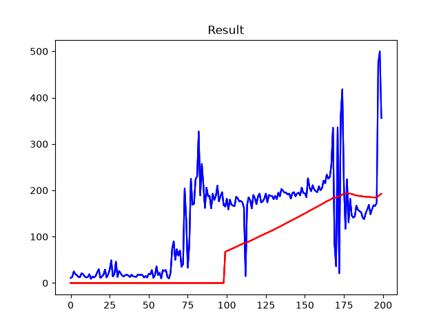
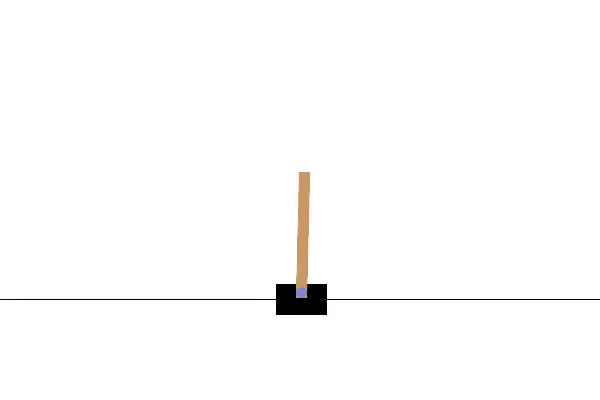

# 🎯 PoleBalance_RL

Balancing an inverted pendulum (the classic **CartPole-v1** problem) using **Deep Reinforcement Learning** — a self-implemention of the **DQN (Deep Q-Network)** algorithm from scratch with **PyTorch** and **Gymnasium**.

---

## 📊 Results

The agent is trained for **200 episodes**. It starts off failing within a few steps and gradually learns to balance the pole — eventually hitting rewards close to the environment cap of **500**.



- 🔵 **Blue line** — total reward per episode
- 🔴 **Red line** — 100-episode moving average (the true performance trend, reaching ~200)

---
## Agent GamePlay ##


## 🧠 How It Works

The project follows the DQN recipe from *"Human-level control through deep reinforcement learning"* (Mnih et al., 2015):

| Component | Implementation |
|---|---|
| **Environment** | `CartPole-v1` from Gymnasium |
| **Network** | MLP `4 → 128 → 128 → 2` (state → Q-values for push-left / push-right) |
| **Replay Memory** | Fixed-size buffer (10,000 transitions) for experience replay |
| **Target Network** | Separate target net, **soft-updated** every step with `τ = 0.005` |
| **Exploration** | ε-greedy with exponential decay: ε from `0.9 → 0.01` |
| **Loss** | Huber (smooth L1) loss on TD error |
| **Optimizer** | AdamW with AMSGrad, gradient clipping at 100 |

### Hyperparameters

```python
BATCH_SIZE = 128
GAMMA      = 0.99     # discount factor
EPS_START  = 0.9      # initial exploration rate
EPS_END    = 0.01     # final exploration rate
EPS_DECAY  = 2500     # decay speed (in steps)
TAU        = 0.005    # target network soft-update rate
LR         = 3e-4     # learning rate
```

### Environment

| | |
|---|---|
| **State** (4 dims) | cart position, cart velocity, pole angle, pole angular velocity |
| **Actions** (2) | push cart left / right |
| **Reward** | +1 for every surviving time-step (max 500 per episode) |

## 📁 Project Structure

```
PoleBalance_RL/
├── train.py            # Full DQN training loop (trains the agent, saves model + plot)
├── play.py             # Loads the trained model and renders it balancing the pole
├── train.ipynb         # Colab notebook version of the training pipeline
├── dpn_cartpole.pth    # Saved (pre-trained) DQN policy network weights
├── resultDQN.png       # Training results — rewards per episode
├── requirement.txt     # Pinned dependencies
└── venv/               # Local virtual environment (gitignored)
```

## ⚙️ Installation

```bash
git clone <your-repo-url>
cd PoleBalance_RL

# create and activate a virtual environment
python -m venv venv
venv\Scripts\activate        # Windows
source venv/bin/activate     # Linux / macOS

pip install -r requirement.txt
```

> **Main requirements:** `torch 2.x`, `gymnasium`, `matplotlib`, `pygame-ce` (needed by CartPole's `human` render mode), `numpy`

## 🚀 Usage

**Train the agent** (outputs `resultDQN.png` and overwrites `dpn_cartpole.pth`):

```bash
python train.py
```

**Watch the trained agent play** (opens a live window of the cart balancing the pole):

```bash
python play.py
```

> Note: `play.py` loads `dpn_cartpole.pth`, so a trained model comes bundled with this repo — you can watch it balance right away without retraining. Runs on CPU or GPU automatically (CUDA is detected if available).

## 💡 Notes & Possible Improvements

- Training for 200 episodes is a benchmark run — extending to 300–500 episodes makes the moving average converge near 500.
- The 100-episode moving average is a built-in "solved" check too — consider adding an **early-stopping condition** when the average reward ≥ 475 (Gymnasium's official solved threshold for CartPole).
- Ideas to extend: **Double DQN**, **Dueling DQN**, or **Prioritized Experience Replay** for faster, more stable convergence.

## 📚 References

- [Human-level control through deep reinforcement learning (Mnih et al., 2015)](https://www.nature.com/articles/nature14236)
- [PyTorch DQN Tutorial](https://docs.pytorch.org/tutorials/intermediate/reinforcement_q_learning.html)
- [CartPole-v1 — Gymnasium Documentation](https://gymnasium.farama.org/environments/classic_control/cart_pole/)
